# `@plaans` — One Link for Every Plan

**Plaans** is a visual itinerary and event plan builder web application built with **Flutter Web** and **Provider**. Inspired by the design-first link-in-bio aesthetic of [Liinks.co](https://www.liinks.co/) and the modular layout studio of Squarespace, Plaans lets creators, travelers, and event hosts design custom shareable itinerary microsites with **Google Maps & Apple Maps GPS navigation**, drag-and-drop block customization, and image uploads.

---

## ✨ Key Features

### 1. Liinks.co-Inspired Landing & Showcase Experience
- **Floating Frosted Pill Navbar**: Clean glassmorphic navigation bar (`@plaans`, `Itineraries`, `GPS & Maps`, `Templates`, `Studio Editor`, and `Get started`).
- **Pastel Aurora Glow Canvas (`LiinksAuroraBackground`)**: Soft radial lavender (`#E0E7FF`), sky-blue (`#DFF2FE`), and rose (`#FCE7F3`) ambient background glows.
- **Instant Slug Claim Bar**: Type any custom slug into `plaans.co/your-trip` and click **Get Started** to immediately generate and launch a new itinerary in the Studio.
- **3 Fanned Interactive Phone Previews & "Made with Plaans" Gallery**: Live preview cards showcasing real starter itineraries (*72 Hours in Tokyo*, *NYC Downtown Saturday*, *Amalfi Coast Sun & Sea*) that open in the Studio with a single click.

### 2. 3-Column Live Studio Editor ("Edit it live, see it instantly")
- **Leftmost Dark Icon Rail (`#181920`)**: Quick navigation between Landing Home, Content & Blocks, Styles & Colors, GPS & Maps Hub, Saved Plans, Device Viewport Toggle, and QR Code Sharing.
- **`Content | Styles` Segmented Inspector Panel**:
  - **Content Tab**: 6 one-click block creation pills + drag-and-drop block reorder list.
  - **Styles Tab**: Liinks-style expandable color rows (`Background`, `Text Color`, `Block Surface Color`, `Label & GPS Accent Color`) with right-aligned circular color swatches, Undo/Preset Cycle buttons, typography pairings, and card surface styles.
- **Realistic Phone Mockup & Desktop Preview Stage**:
  - Switch between **Phone Preview** (dark-bezel phone frame featuring a live `plaans.co/<slug>` top URL bar with copy/share actions) and **Desktop Web Layout**.

### 3. Modular Drag-and-Drop Block System
Every Plan is composed of a centered **Profile Header** (circular avatar, title, `@handle`, dates, bio, quick-action icons, and centered Day Pill Tabs) followed by a reorderable list of modular blocks:

| Block Type | Enum | Description |
| :--- | :--- | :--- |
| **Place / Event Stop** | `BlockType.placeEvent` | Renders as a **Liinks Split Left-Thumbnail Card** (standard/halfWidth) or a **Full-Bleed Hero Showcase Card** (`featured`). Includes start/end times, category badge, cost note, external ticket/reservation URL, and **1-tap Google Maps GPS & Apple Maps GPS buttons**. |
| **Interactive Route Map** | `BlockType.mapOverview` | Embedded interactive map (`flutter_map`) plotting all stops with numbered pins, connecting route polylines, horizontal stop quick-jump chips, and **Full Route in Google Maps / Apple Maps GPS** buttons. |
| **Link Button Card** | `BlockType.linkCard` | Classic Liinks.co pill button row with a `44x44` left thumbnail/icon, centered bold title & subtitle, and external link launcher. |
| **Photo Upload Block** | `BlockType.photoGallery` | Upload local images (`PNG`, `JPG`, `WEBP`, `GIF`) from your device or choose from the curated travel photography gallery. |
| **Day / Section Divider** | `BlockType.dayHeader` | Divides an itinerary into days or phases (`Day 1`, `Day 2`, `Friday`) and automatically populates the sticky **Day Filter Pill Tabs** at the top of the page. |
| **Folder / Group Note** | `BlockType.textNote` | Clean callout card for packing lists, dress codes, Wi-Fi passwords, or group reminders. |

### 4. Google Maps & Apple Maps GPS Integration
- **Per-Stop Turn-by-Turn GPS Deep Links**:
  - **Google Maps Directions**: `https://www.google.com/maps/dir/?api=1&destination=<query_or_lat_lng>`
  - **Google Maps Pin Search**: `https://www.google.com/maps/search/?api=1&query=<query>`
  - **Apple Maps Directions**: `https://maps.apple.com/?daddr=<lat>,<lng>&q=<name>&dirflg=d`
  - **Apple Maps Pin Search**: `https://maps.apple.com/?q=<name>&ll=<lat>,<lng>`
- **Multi-Stop Full Itinerary Route URL**:
  - Combines the first stop (`origin`), intermediate stops (`waypoints`), and final stop (`destination`) into a single multi-stop Google Maps or Apple Maps navigation link so travelers can open an entire day's route in one tap.
- **Built-In Place & Address Geocoding**:
  - Search any venue, landmark, or street address inside the Block Editor Modal to automatically resolve and fill its GPS `latitude` and `longitude` via OpenStreetMap Nominatim + curated instant landmarks.

### 5. Curated Themes & Visual Customization
Includes 6 built-in themes inspired by featured pages on `liinks.co`:
1. **Wildstem Cream** (`#F6EFEA` floral cream canvas, `Playfair Display` editorial headings, white soft-glow cards)
2. **Bakehouse Crimson** (`#8B1E29` deep berry canvas, crisp white split-thumbnail cards, `Plus Jakarta Sans`)
3. **Lune Studio White** (`#FFFFFF` minimal canvas, `#F4F4F6` soft pill rows, terracotta accent)
4. **Athletic Teal** (`#0A2A36` deep navy canvas, `#35C9D6` vibrant cyan cards, `Space Grotesk`)
5. **Parita Plum** (`#5D4E60` muted plum canvas, rose-gold accents, `DM Sans`)
6. **Goodee Sandstone** (`#E3D8C8` warm parchment canvas, crisp outline borders, golden accents)

### 6. Instant Sharing & QR Codes
- **Clean Slug Links**: Share via `/#/p/<slug>` (e.g., `/#/p/tokyo-72-hours`).
- **Self-Contained Portable URLs**: Encodes the entire plan JSON & theme into a URL-safe base64 query parameter (`/#/p/<slug>?data=...`) so anyone can open the exact customized itinerary on any device without requiring a login.
- **QR Code Generator**: Built-in scannable QR code inside the Share modal (`qr_flutter`) for sharing itineraries in person.

---

## 🏗️ Architecture Overview

```mermaid
flowchart LR
    subgraph Screens["UI Screens (lib/screens/)"]
        Landing["LiinksLandingScreen\n(Hero + Claim Bar + Fanned Phones)"]
        Studio["StudioScreen\n(Dark Rail + Content/Styles + Phone Stage)"]
        Visitor["PublicVisitorPreviewScaffold\n(Distraction-Free Shared View)"]
    end

    subgraph Widgets["Modular Widgets (lib/widgets/)"]
        Canvas["PlanPageCanvas\n(Centered Profile + Day Pill Tabs)"]
        Blocks["PlanBlockRenderer\n(Split-Thumbnail & Pill Cards)"]
        MapWidget["InteractivePlanMap\n(Numbered Pins + Route Polyline)"]
        Editor["BlockEditorModal\n(Place Search + Image Upload)"]
        ShareModal["SharePlanDialog\n(QR Code + Portable Link)"]
    end

    subgraph State["Provider State (lib/providers/)"]
        Provider["PlanStudioProvider\n(ChangeNotifier)"]
    end

    subgraph Services["Services & Storage (lib/services/)"]
        MapsSvc["MapsService\n(Google/Apple Maps GPS + Geocoding)"]
        ImgSvc["ImageService\n(FilePicker Base64 + Gallery)"]
        Repo["PlanRepository\n(SharedPreferences + URL Payload)"]
    end

    Screens --> Widgets
    Screens --> State
    Widgets --> State
    State --> Services
```



---

## 📂 Project Structure

```text
plaans/
├── lib/
│   ├── main.dart                         # App entry point, MultiProvider & /#/p/<slug> URL route handler
│   ├── models/
│   │   └── plan_models.dart              # PlanModel, PlanBlock, PlanTheme, LocationData & base64 share encoder
│   ├── providers/
│   │   └── plan_studio_provider.dart     # ChangeNotifier managing active plan, drag-and-drop, themes & filters
│   ├── services/
│   │   ├── maps_service.dart             # Google Maps & Apple Maps GPS URL builders + Nominatim place search
│   │   ├── image_service.dart            # Device image upload (FilePicker) & curated travel photo library
│   │   └── plan_repository.dart          # Local persistence, starter templates & shareable slug lookup
│   ├── screens/
│   │   ├── liinks_landing_screen.dart    # Liinks.co-style landing page with claim bar & fanned phone cards
│   │   └── studio_screen.dart            # 3-column live Studio editor & public visitor preview scaffold
│   └── widgets/
│       ├── plan_page_canvas.dart         # Centered Liinks profile header, day pill tabs & reorderable block list
│       ├── block_widgets.dart            # Split left-thumbnail event cards, pill link rows, galleries & notes
│       ├── interactive_plan_map.dart     # Multi-stop FlutterMap with numbered markers & GPS route chips
│       ├── block_editor_sheet.dart       # Modal inspector for editing blocks, searching GPS coordinates & uploading photos
│       ├── share_plan_dialog.dart        # QR code generator, clean link & portable URL copy modal
│       └── plan_image.dart               # Theme typography/decorations, LiinksAuroraBackground & image renderer
├── test/
│   └── widget_test.dart                  # Unit tests for GPS URLs, multi-stop routes, URL sharing & reordering
└── pubspec.yaml                          # Flutter dependencies & configuration
```

---

## 🚀 Getting Started

### Prerequisites
- **Flutter SDK**: `>=3.10.0` (tested with Flutter `3.47.0` / Dart `3.13.0`)
- A modern web browser (Chrome, Edge, Safari, or Firefox)

### 1. Install Dependencies
```bash
flutter pub get
```

### 2. Run in Development Mode
```bash
flutter run -d chrome
```

### 3. Run Static Analysis & Automated Tests
```bash
flutter analyze
flutter test
```

### 4. Build for Production Web
```bash
flutter build web --release
```
The compiled static web bundle is output to `build/web/` and can be deployed directly to **Firebase Hosting**, Vercel, Netlify, or served locally:
```bash
python3 -m http.server 8099 --directory build/web
```
