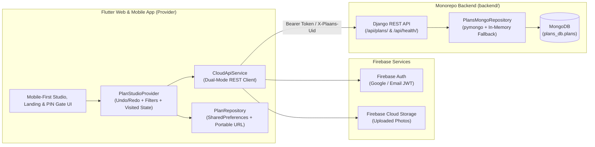

# `@plaans` — One Link for Every Plan

**Plaans** is a 100% mobile-first visual itinerary and event plan builder built with **Flutter**, **Provider**, **Firebase**, **Django REST Framework**, and **MongoDB**. Inspired by the design-first link-in-bio aesthetic of [Liinks.co](https://www.liinks.co/) and the modular layout studio of Squarespace, Plaans lets creators, travelers, and event hosts design custom shareable itinerary microsites with **Google Maps & Apple Maps GPS navigation**, drag-and-drop block customization, image uploads, and cloud vanity slugs.

---

## ✨ Key Features

### 1. 100% Mobile-First Experience Across Every Screen
- **Mobile-First Studio Editor (`< 760px`)**:
  - Renders the live itinerary canvas **full-bleed** (edge-to-edge without redundant phone bezels on mobile screens).
  - **Compact Mobile Top Bar**: One-tap `plaans.co/<slug>` copy pill, Undo/Redo, Live Visitor Preview toggle, and Share button.
  - **Thumb-Friendly Bottom Navigation Bar**: Switch with one thumb between **Canvas**, **Blocks**, **Styles**, **GPS**, and **Plans**, paired with a floating **+ Add Block** action button.
- **Desktop 3-Column Live Studio (`>= 960px`)**:
  - Automatically expands into the Liinks.co 3-column Studio layout: leftmost dark icon rail (`#181920`), `Content | Styles` white inspector panel, and right Phone Mockup / Desktop stage.
- **Adaptive Bottom-Sheet Modals**:
  - Both the **Block Editor (`BlockEditorModal`)** and **Share & Publish Modal (`SharePlanDialog`)** open as smooth, scrollable modal bottom sheets on phones and centered dialogs on desktop.
- **Mobile-First Landing & Showcase (`LiinksLandingScreen`)**:
  - Features a floating frosted pill navbar, pastel aurora background (`LiinksAuroraBackground`), instant `plaans.co/your-trip` slug claim bar, a touch-friendly **horizontal swipeable phone carousel** on mobile (and 3-phone fan on desktop), and the *"Made with Plaans"* starter gallery.

### 2. Creator & Traveler UX Enhancements
- **20-Step Undo / Redo & Delete Recovery**:
  - Full `_undoStack` and `_redoStack` in `PlanStudioProvider` with Undo/Redo buttons in the Studio top bar and an instant **"Deleted block — UNDO"** floating snackbar whenever a card is removed.
- **Next-Stop Distance & Walk/Drive ETA Badges (`MapsService.formatTravelLegSummary`)**:
  - Computes real-time Haversine distance between consecutive GPS stops and displays a connector pill below each stop (`Next stop: 0.9 km · ~11 min walk` or `4.2 km · ~12 min drive`).
- **Interactive Traveler Check-Off (`Visited ✓`) & Progress Tracker**:
  - Guests can tap **Check off / Visited** on any stop card as they move through the city, persisted per-device in `SharedPreferences` and summarized in the header (`2/6 Visited ✓`).
- **1-Tap Google Calendar Export (`+ Cal`)**:
  - Timed event and reservation cards include a `+ Cal` / `+ Add to Calendar` pill next to the Google Maps and Apple Maps GPS buttons that pre-fills the event title, time, notes, and venue address in Google Calendar.
- **At-a-Glance Trip Summary & Instant Category Filters**:
  - Displays an automatic summary strip below the bio (`3 Days · 6 Stops · Est. $73 · 2/6 Visited ✓`) by parsing stop counts and `costEstimate` fields, plus horizontal category filter chips (`All Stops`, `Food & Drink`, `Sightseeing`, `Nightlife`).

### 3. Modular Drag-and-Drop Block System
Every Plan is composed of a centered **Profile Header** (circular avatar, title, `@handle`, dates, bio, quick-action icons, and centered Day Pill Tabs) followed by a reorderable list of modular blocks:

| Block Type | Enum | Description |
| :--- | :--- | :--- |
| **Place / Event Stop** | `BlockType.placeEvent` | Renders as a **Liinks Split Left-Thumbnail Card** (`standard`/`halfWidth`) or a **Full-Bleed Hero Showcase Card** (`featured`). Includes start/end times, category badge, cost note, `Visited ✓` check-off, `+ Cal` export, external booking URL, and **1-tap Google Maps GPS & Apple Maps GPS buttons**. |
| **Interactive Route Map** | `BlockType.mapOverview` | Embedded interactive map (`flutter_map`) plotting all stops with numbered pins, connecting route polylines, horizontal stop quick-jump chips, and **Full Route in Google Maps / Apple Maps GPS** buttons. |
| **Link Button Card** | `BlockType.linkCard` | Classic Liinks.co pill button row with a `44x44` left thumbnail/icon, centered bold title & subtitle, and external link launcher. |
| **Photo Upload Block** | `BlockType.photoGallery` | Upload local images (`PNG`, `JPG`, `WEBP`, `GIF`) from your device or choose from the curated travel photography gallery. |
| **Day / Section Divider** | `BlockType.dayHeader` | Divides an itinerary into days or phases (`Day 1`, `Day 2`, `Friday`) and automatically populates the sticky **Day Filter Pill Tabs** at the top of the page. |
| **Folder / Group Note** | `BlockType.textNote` | Clean callout card for packing lists, dress codes, Wi-Fi passwords, or group reminders. |

### 4. Google Maps & Apple Maps GPS Integration
- **Per-Stop Turn-by-Turn GPS Deep Links**:
  - **Google Maps Directions**: `https://www.google.com/maps/dir/?api=1&destination=<query_or_lat_lng>`
  - **Google Maps Pin Search**: `https://www.google.com/maps/search/?api=1&query=<query>`
  - **Apple Maps Directions**: `https://maps.apple.com/?daddr=<lat>,<lng>&q=<name>&dirflg=d`
  - **Apple Maps Pin Search**: `https://maps.apple.com/?q=<name>&ll=<lat>,<lng>`
- **Multi-Stop Full Itinerary Route URL**:
  - Combines the first stop (`origin`), intermediate stops (`waypoints`), and final stop (`destination`) into a single multi-stop Google Maps or Apple Maps navigation link so travelers can open an entire day's route in one tap.
- **Built-In Place & Address Geocoding**:
  - Search any venue, landmark, or street address inside the Block Editor Modal to automatically resolve and fill its GPS `latitude` and `longitude` via OpenStreetMap Nominatim + curated instant landmarks.

### 5. Hybrid Cloud Backend (Firebase + Django REST API + MongoDB)
- **Try-Before-Signup Dual-Mode Architecture**:
  - Works out-of-the-box offline via `SharedPreferences` and seamlessly syncs to the **Django + MongoDB REST API (`backend/`)** when online.
- **Custom Vanity Slugs (`plaans.co/<slug>`)**:
  - Live slug availability check (`GET /api/plans/check-slug/<slug>/`) with `AVAILABLE` / `TAKEN` badge in the Share modal.
- **3 Visibility & Privacy Modes (`PlanVisibility`)**:
  - **Public**: Discoverable and viewable via `plaans.co/<slug>`.
  - **Unlisted Link**: Viewable by anyone with the link.
  - **PIN Protected**: Requires a 4–6 digit group trip PIN (verified via SHA-256 hash on the Django + MongoDB backend) before unlocking the itinerary in `_PinProtectedUnlockView`.
- **Self-Contained Portable URLs & QR Codes**:
  - Also supports serverless base64 URL payloads (`/#/p/<slug>?data=...`) and an instant scannable QR code (`qr_flutter`).

### 6. Curated Themes & Visual Customization
Includes 6 built-in themes inspired by featured pages on `liinks.co`:
1. **Wildstem Cream** (`#F6EFEA` floral cream canvas, `Playfair Display` editorial headings, white soft-glow cards)
2. **Bakehouse Crimson** (`#8B1E29` deep berry canvas, crisp white split-thumbnail cards, `Plus Jakarta Sans`)
3. **Lune Studio White** (`#FFFFFF` minimal canvas, `#F4F4F6` soft pill rows, terracotta accent)
4. **Athletic Teal** (`#0A2A36` deep navy canvas, `#35C9D6` vibrant cyan cards, `Space Grotesk`)
5. **Parita Plum** (`#5D4E60` muted plum canvas, rose-gold accents, `DM Sans`)
6. **Goodee Sandstone** (`#E3D8C8` warm parchment canvas, crisp outline borders, golden accents)

---

## 🏗️ Full-Stack Architecture



---

## 📂 Monorepo Project Structure

```text
plaans/
├── lib/
│   ├── main.dart                         # App entry point, MultiProvider & /#/p/<slug> URL route handler
│   ├── models/
│   │   └── plan_models.dart              # PlanModel, PlanVisibility, PlanBlock, PlanTheme & LocationData
│   ├── providers/
│   │   └── plan_studio_provider.dart     # ChangeNotifier (Undo/Redo, drag-and-drop, cloud sync, Visited check-off)
│   ├── services/
│   │   ├── cloud_api_service.dart        # Dual-mode HTTP client for Django + MongoDB API & Creator Auth
│   │   ├── maps_service.dart             # Google/Apple Maps GPS links, Haversine leg ETAs & Google Calendar URLs
│   │   ├── image_service.dart            # Device image upload (FilePicker) & curated travel photo library
│   │   └── plan_repository.dart          # Local persistence, starter templates & shareable slug lookup
│   ├── screens/
│   │   ├── liinks_landing_screen.dart    # Mobile-first landing page with swipeable phone carousel & claim bar
│   │   └── studio_screen.dart            # Mobile full-bleed Studio + bottom nav, 3-column desktop Studio & PIN gate
│   └── widgets/
│       ├── plan_page_canvas.dart         # Centered Liinks profile header, Trip Summary pill, Day & Category tabs
│       ├── block_widgets.dart            # Split-thumbnail event cards, leg distance pills, + Cal & Visited toggles
│       ├── interactive_plan_map.dart     # Multi-stop FlutterMap with numbered markers & GPS route chips
│       ├── block_editor_sheet.dart       # Responsive bottom-sheet / dialog inspector with place geocoding
│       ├── share_plan_dialog.dart        # Vanity slug checker, Public/Unlisted/PIN privacy, Cloud Sync & QR code
│       └── plan_image.dart               # Theme typography/decorations, LiinksAuroraBackground & image renderer
├── backend/
│   ├── manage.py                         # Django CLI entry point
│   ├── requirements.txt                  # Django, DRF, django-cors-headers, pymongo, firebase-admin
│   ├── Dockerfile & docker-compose.yml   # One-command MongoDB 7 + Django API container setup
│   ├── plaans_api/                       # Django project configuration, CORS & settings
│   └── plans/                            # REST endpoints (views.py), MongoDB repository (mongo_repo.py) & tests
├── .github/
│   └── workflows/
│       └── ci_cd.yml                     # Full-Stack GitHub Actions CI/CD pipeline (Flutter + Django/MongoDB + Docker)
├── web/
│   ├── index.html                        # Modern mobile-first HTML5 shell (100dvh, clamp(), fetchpriority="high")
│   └── manifest.json                     # PWA manifest
├── test/
│   └── widget_test.dart                  # Unit tests for GPS URLs, routes, PIN unlock, Undo/Redo & leg ETAs
└── pubspec.yaml                          # Flutter dependencies & configuration
```

---

## ⚙️ Full-Stack CI/CD Pipeline (`.github/workflows/ci_cd.yml`)

Every push and pull request targeting `main` (plus manual `workflow_dispatch`) triggers the automated 3-stage GitHub Actions pipeline:

1. **`flutter-ci` (Flutter Analyze, Test & Web Build)**:
   - Installs dependencies (`flutter pub get`), runs `flutter analyze --no-fatal-infos`, executes all unit & widget tests (`flutter test --reporter expanded`), builds the release web bundle (`flutter build web --release`), and uploads the `plaans-web-release` artifact.
2. **`backend-ci` (Django REST API & MongoDB 7 Tests)**:
   - Provisions a live `mongo:7` service container, runs `python manage.py check`, and runs the full Django REST test suite against both live MongoDB (`MONGODB_URI=mongodb://localhost:27017`) and the offline in-memory fallback store.
3. **`docker-smoke-test` (Docker Compose Build & Full-Stack Smoke Test)**:
   - Downloads the compiled `build/web` artifact, builds and boots the full `docker compose` stack (`mongodb` + `api` + `web`), verifies `http://localhost:8088/api/health/` reports `"storageEngine": "mongodb"`, and confirms Nginx serves the Flutter Web app on `http://localhost:8099/`.

---

## 🚀 Getting Started

### Prerequisites
- **Flutter SDK**: `>=3.10.0` (tested with Flutter `3.47.0` / Dart `3.13.0`)
- **Python**: `>=3.9` (for the Django + MongoDB REST API in `backend/`)
- **MongoDB**: Local MongoDB (`localhost:27017`) or Docker (automatically falls back to an in-memory store if MongoDB is not running)

### 1. Run the Flutter Web App
```bash
flutter pub get
flutter run -d chrome
```
Or build and serve the production web bundle on port `8099`:
```bash
flutter build web
python3 -m http.server 8099 --directory build/web
```

### 2. Run the Django + MongoDB Backend (`backend/`)
**Using Python `venv`:**
```bash
cd backend
python3 -m venv .venv
.venv/bin/pip install -r requirements.txt
.venv/bin/python manage.py test
.venv/bin/python manage.py runserver 0.0.0.0:8088
```
**Or using Docker Compose:**
```bash
cd backend
docker compose up --build
```
Verify backend health at `http://localhost:8088/api/health/`.

### 3. Run Static Analysis & Automated Tests
```bash
# Flutter static analysis & unit tests
flutter analyze
flutter test

# Django + MongoDB API tests
cd backend && .venv/bin/python manage.py test
```
